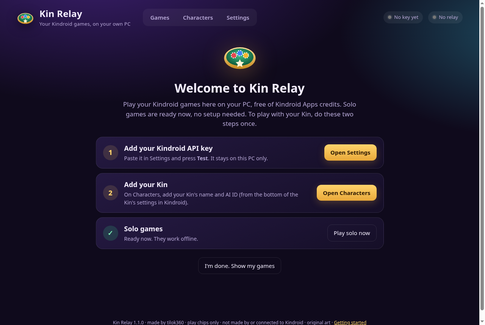
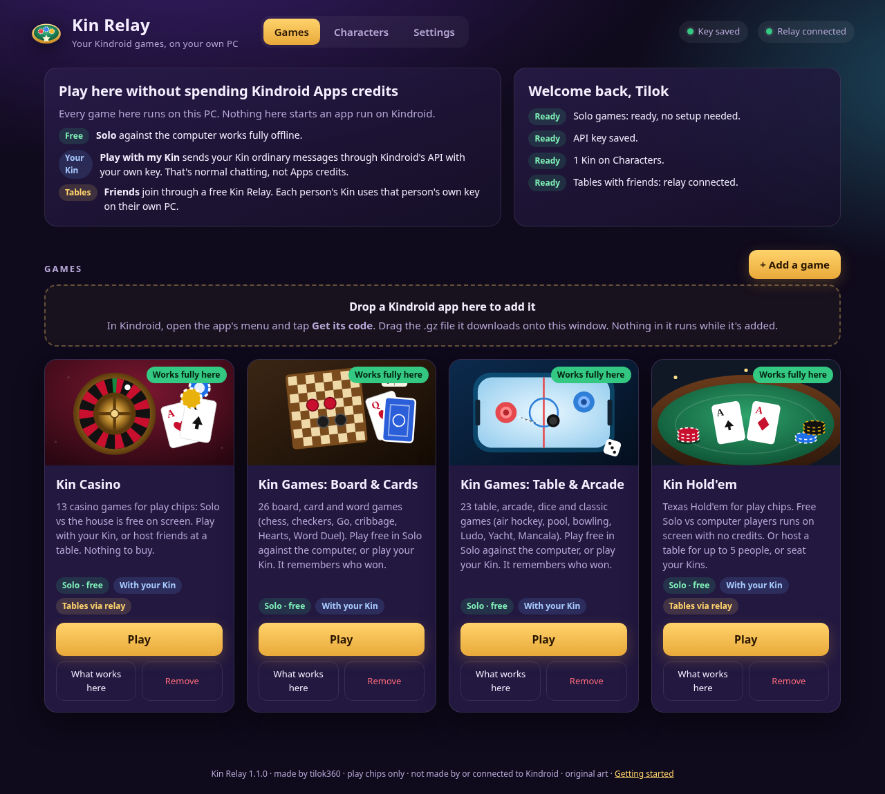

# Kin Relay

Play your Kindroid games on your own Windows PC, add any Kindroid app by dragging in its **Get its code** file, and host tables for friends. Nothing in Kin Relay uses Kindroid Apps credits.

Made by tilok360 · free and open source (MIT) · play chips only · a fan-made tool, not made by or connected to Kindroid.

## Download (Windows 10/11)

**[⬇ Download Kin-Relay-Setup.exe](https://github.com/tilok360/kin-relay/releases/latest/download/Kin-Relay-Setup.exe)** (about 110 MB)

1. Double-click **Kin-Relay-Setup.exe**.
2. Windows may show **"Windows protected your PC"**. Kin Relay is free and isn't code-signed (a signing certificate costs money every year), so Windows doesn't recognise it yet. Click **More info**, then **Run anyway**.
3. Click **Install**. It installs just for you (no administrator needed), adds Kin Relay to your Start menu and desktop, and opens it.

You don't need to install anything else. To remove it, go to Windows Settings > Apps > Kin Relay > Uninstall.

No installer? Download the **[portable zip](https://github.com/tilok360/kin-relay/releases/latest/download/Kin-Relay-Portable.zip)**, unzip it and double-click `Start Kin Relay.bat`. It runs in your browser and downloads a private copy of Node.js the first time if you don't have one. On Mac or Linux, run `start-kin-relay.sh` (Node.js 22 or newer).

## First start

Solo games work right away, offline. To play with your Kin, there are two short steps:

1. **Settings.** Paste your Kindroid API key (Kindroid: Profile > Preferences > API & Integrations; it starts with `kn_`), then press **Test**. Kin Relay tells you plainly whether Kindroid accepted it. The key is saved only on your PC. In the Windows app it's encrypted by Windows for your account (DPAPI).
2. **Characters.** Add your Kin: a name and its **AI ID** (at the very bottom of the Kin's settings in Kindroid). You can also add a picture and notes. Add as many Kins as you like, and pick which ones play each game.

| Settings | Characters |
|---|---|
|  |  |

## What's inside

- **Games that come with it:** Kin Casino, Kin Hold'em, Kin Games Table & Arcade, and Kin Games Board & Cards.
- **Drag and drop any Kindroid app:** in Kindroid, open an app's menu and tap **Get its code**, then drag the `.gz` onto the Kin Relay window. Kin Relay checks it safely: no files outside its folder, size limits, and nothing in it runs while it's added. It then tells you what works here and what can't work outside Kindroid.
- **Play with your Kin:** your Kin is asked through Kindroid's public API with your own key. These are normal Kin messages, not Apps runs.
- **Tables with friends:** everyone uses the same free relay, which you can run on your PC, on a free tunnel, or on a free Cloudflare Workers or Render host. The host deals with secure random numbers, hidden cards go only to their owner, and each player's Kin uses that player's own key on their own PC. See `README.txt`, "How to host".

## Good to know

- Kindroid allows 10 API requests every 30 seconds per account, and Kin Relay waits its turn.
- In "In your chat" mode, the game's questions and your Kin's answers show up in your chat with that Kin. "Quietly" mode needs a share code and a subscription.
- It isn't known for sure whether Kindroid counts API messages against anything, or what its terms say about tools like this. Check your account after a first session, and read Kindroid's current terms.
- Your Kin's voice, selfies, messages into your Kindroid chat, and scheduled runs don't work outside Kindroid.

## For app makers and developers

- `ADAPTER-GUIDE.md`: how Kin Relay runs Kindroid apps (the screen bridge, the `kin` command shim, and the relay protocol).
- `server.js` is the app (plain Node.js with no packages). `relay.js` is the relay. `cloudflare/` has the Workers relay. `desktop/` builds the Windows installer (Electron and electron-builder; `cd desktop && npm install && node build.js dist`, which needs wine on Linux).
- Tests are in `dev/`: `smoke.py` (headless Chrome: solo, Kin via a mock API, a two-player table, drag-and-drop), `desktop-ui.test.py` (the Electron window), `installer.test.js`, and `relay-protocol.test.js`. They never contact Kindroid. The drag-and-drop tests need a "Get its code" download saved as `samples/kindroid-get-code-sample.gz`, which isn't included here.
