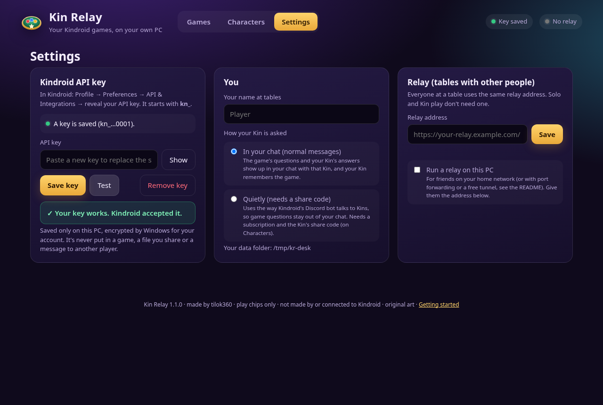
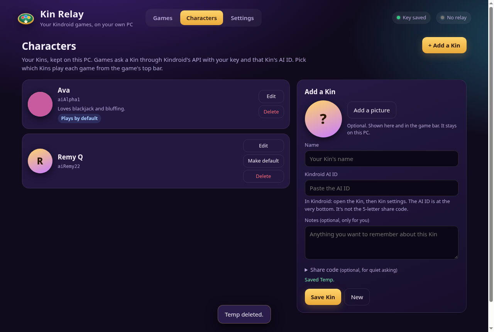
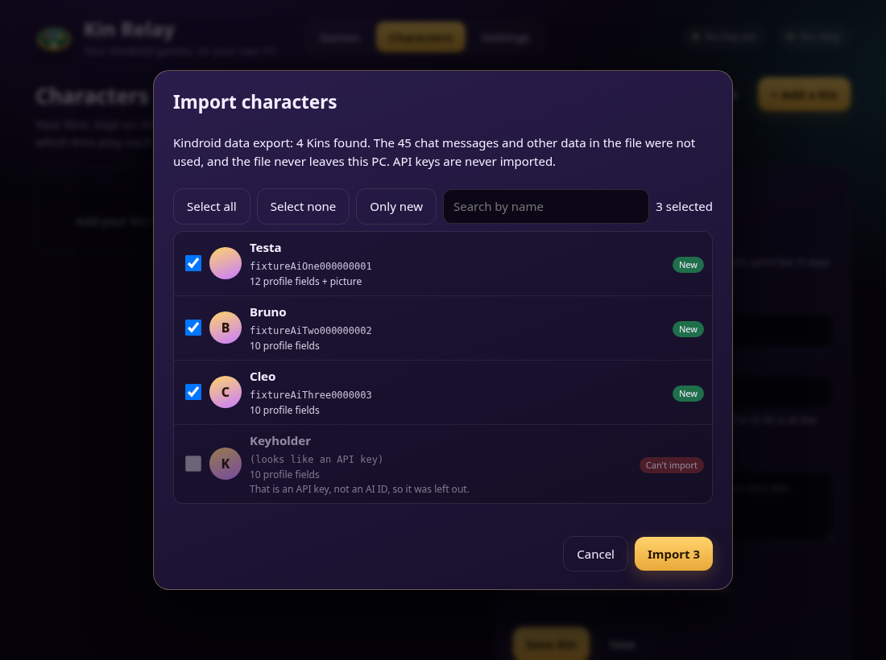
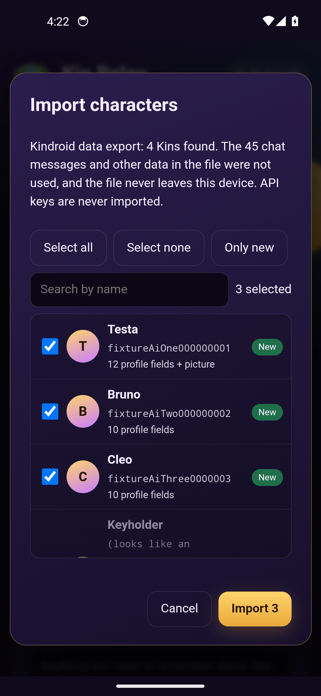

# Kin Relay

Play your Kindroid games on Windows, Mac, Android and iPhone, add any Kindroid app by dragging in its **Get its code** file, and host tables for friends. Nothing in Kin Relay uses Kindroid Apps credits.

Made by tilok360 · free and open source (MIT) · play chips only · a fan-made tool, not made by or connected to Kindroid.

## Download

Pick your device. Every link always points at the newest version.

| Device | Download | Notes |
|---|---|---|
| **Windows 10/11** | **[Kin-Relay-Setup.exe](https://github.com/tilok360/kin-relay/releases/latest/download/Kin-Relay-Setup.exe)** (about 110 MB) | Installer. Also: [portable zip](https://github.com/tilok360/kin-relay/releases/latest/download/Kin-Relay-Portable.zip) |
| **Mac, Apple Silicon** (M1 or newer) | **[Kin-Relay-Mac-AppleSilicon.zip](https://github.com/tilok360/kin-relay/releases/latest/download/Kin-Relay-Mac-AppleSilicon.zip)** | Unzip, drag **Kin Relay** into Applications |
| **Mac, Intel** | **[Kin-Relay-Mac-Intel.zip](https://github.com/tilok360/kin-relay/releases/latest/download/Kin-Relay-Mac-Intel.zip)** | Same steps |
| **Android** | **[Kin-Relay.apk](https://github.com/tilok360/kin-relay/releases/latest/download/Kin-Relay.apk)** (about 1 MB) | Sideload (not on Google Play) |
| **iPhone / iPad** | **[Open Kin Relay in Safari](https://tilok360.github.io/kin-relay/)** | Free web app, add it to your Home Screen |
| Checksums | [SHA256SUMS.txt](https://github.com/tilok360/kin-relay/releases/latest/download/SHA256SUMS.txt) | |

### Windows
1. Double-click **Kin-Relay-Setup.exe**.
2. Windows may show **"Windows protected your PC"**. Kin Relay is free and isn't code-signed (a signing certificate costs money every year), so Windows doesn't recognise it yet. Click **More info**, then **Run anyway**.
3. Click **Install**. It installs just for you (no administrator needed), adds Kin Relay to your Start menu and desktop, and opens it.

To remove it, go to Windows Settings > Apps > Kin Relay > Uninstall. No installer? Unzip the portable zip and double-click `Start Kin Relay.bat`. It runs in your browser and downloads a private copy of Node.js the first time if you don't have one. On Linux, run `start-kin-relay.sh` (Node.js 22 or newer).

### Mac
Kin Relay for Mac is free and not signed by Apple (that needs a paid developer account), so the first time macOS will say it can't verify it. The app is ad-hoc signed, and this is how to open it:
1. Unzip the download and drag **Kin Relay** into **Applications**.
2. In Applications, **right-click (or Control-click) Kin Relay and choose Open**, then click **Open** in the box that appears.
3. If macOS only offers "Done" or "Move to Trash", press **Done**, open **System Settings > Privacy & Security**, scroll down to "Kin Relay was blocked" and click **Open Anyway**. Enter your password, then **Open**.
4. Still says the app is "damaged"? Open Terminal and run `xattr -cr "/Applications/Kin Relay.app"`, then open it again. That only removes the "downloaded from the internet" flag.

You only do this once. It hasn't been tried on a real Mac yet (it was built and checked on Linux), so tell tilok360 if something doesn't open. There's no .dmg because a .dmg can only be built on a Mac.

### Android
1. On your phone, open the **Kin-Relay.apk** link and download it.
2. Open the file. Android asks permission to **install unknown apps** for the app you opened it from (Chrome, Files...). Turn on **Allow from this source**, go back, and tap **Install**. Google Play Protect may say it hasn't seen the app before: choose **Install anyway**.
3. Open **Kin Relay**. Turn the permission off again afterwards if you like.

The app is signed with its own free key, not Google Play's, so it's installed by hand and updated by installing a newer .apk over it. It asks for the Internet permission only. Android 8 or newer.

### iPhone and iPad
1. Open **[tilok360.github.io/kin-relay](https://tilok360.github.io/kin-relay/)** in **Safari**.
2. Tap the **Share** button, then **Add to Home Screen**, then **Add**.
3. Open Kin Relay from your Home Screen. It opens full screen like an app and works offline after the first visit.

It's a free web app, so there's no App Store and no download to approve. iPhone keeps a Home Screen app's storage apart from Safari's, so set up your key and Kins in the Home Screen app (or move Kins with Export and Import).

### What works on each device
| | Windows / Mac | Android / iPhone |
|---|---|---|
| The four built-in games, solo | yes | yes |
| Play with your Kin (your key, Kindroid's API) | yes | yes |
| Characters, Import and Export | yes | yes |
| Add a game from a "Get its code" file | drag and drop | tap to pick the file |
| Tables with friends | yes (also host a relay on your PC) | yes, while the app is open on screen |
| Added games that wait for your Kin to answer in a single blocking step | yes | no (the games that come with Kin Relay are fine) |
| Run a relay for others on your device | yes | no (use the free Cloudflare relay) |

On a phone or in the web app there's no PC behind it: the games run inside the app, your API key stays in that app's storage on the device, and nothing but Kindroid's API and your relay is contacted. Kindroid's API accepts calls straight from the app, so no go-between server is involved and your key is never sent anywhere else.

## First start

Solo games work right away, offline. To play with your Kin, there are two short steps:

1. **Settings.** Paste your Kindroid API key (Kindroid: Profile > Preferences > API & Integrations; it starts with `kn_`), then press **Test**. Kin Relay tells you plainly whether Kindroid accepted it. The key is saved only on your PC. In the Windows app it's encrypted by Windows for your account (DPAPI).
2. **Characters.** Add your Kin: a name and its **AI ID** (at the very bottom of the Kin's settings in Kindroid). You can also add a picture and notes. Add as many Kins as you like, and pick which ones play each game.

| Settings | Characters |
|---|---|
|  |  |

### Import and Export your Kins
On **Characters**, **Import** reads the **data export** from Kindroid (the `.jsonl` file), a file saved by Kin Relay's own **Export**, or a Kin Studio character file. Chat history in the file is skipped and never leaves your device. You get a list with a picture, name and AI ID for each Kin, tick the ones you want, and if a Kin is already there you choose **Update** or **Skip**. API keys are never imported. **Export** saves a Kin Relay file (with pictures, never your key) or a Kin Studio file. Everything stays on your device; keep exported files private because they hold your Kins' profiles.

| Import | On Android |
|---|---|
|  |  |

(These pictures use made-up example Kins.)

## What's inside

- **Games that come with it:** Kin Casino, Kin Hold'em, Kin Games Table & Arcade, and Kin Games Board & Cards.
- **Drag and drop any Kindroid app:** in Kindroid, open an app's menu and tap **Get its code**, then drag the `.gz` onto the Kin Relay window. Kin Relay checks it safely: no files outside its folder, size limits, and nothing in it runs while it's added. It then tells you what works here and what can't work outside Kindroid.
- **Play with your Kin:** your Kin is asked through Kindroid's public API with your own key. These are normal Kin messages, not Apps runs.
- **Tables with friends:** everyone uses the same free relay, which you can run on your PC, on a free tunnel, or on a free Cloudflare Workers or Render host. The host deals with secure random numbers, hidden cards go only to their owner, and each player's Kin uses that player's own key on their own PC. See `README.txt`, "How to host".

## Good to know

- Kindroid allows 10 API requests every 30 seconds per account, and Kin Relay waits its turn.
- In "In your chat" mode, the game's questions and your Kin's answers show up in your chat with that Kin. "Quietly" mode needs a share code and a subscription.
- It isn't known for sure whether Kindroid counts API messages against anything, or what its terms say about tools like this. Check your account after a first session, and read Kindroid's current terms.
- Your Kin's voice, selfies, messages into your Kindroid chat, and scheduled runs don't work outside Kindroid.

## For app makers and developers

- `ADAPTER-GUIDE.md`: how Kin Relay runs Kindroid apps (the screen bridge, the `kin` command shim, and the relay protocol).
- `server.js` is the app (plain Node.js with no packages). `relay.js` is the relay. `cloudflare/` has the Workers relay. `desktop/` builds the Windows installer and the Mac zips (Electron and electron-builder; `cd desktop && npm install && node build.js dist` or `node build.js mac`; the Windows build needs wine on Linux, and `desktop/zipapp.py` zips a Mac app). `web/` builds the web and iPhone app (`node web/build.js`, output in `web-dist/`, which can be hosted anywhere static), and `android/` builds the Android app (`android/build.sh`, needs a JDK and the Android SDK command-line tools; set `KR_KEYSTORE` to your own key file, and keep that file safe, because updates need the same key).
- Tests are in `dev/`: `smoke.py` (headless Chrome: solo, Kin via a mock API, a two-player table, drag-and-drop), `desktop-ui.test.py` (the Electron window), `chario.test.js` and `chars-ui.test.py` (Import and Export, with made-up fixtures in `dev/fixtures/`), `web-smoke.py` (the phone/web app as two phones), `installer.test.js`, and `relay-protocol.test.js <relay URL>`. They never contact Kindroid. The drag-and-drop tests need a "Get its code" download saved as `samples/kindroid-get-code-sample.gz`, which isn't included here.
